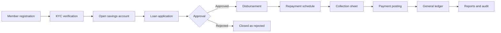
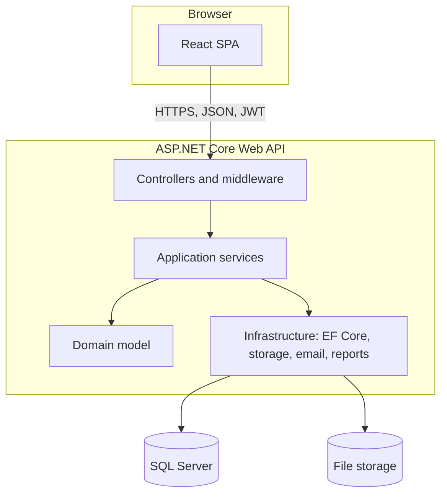
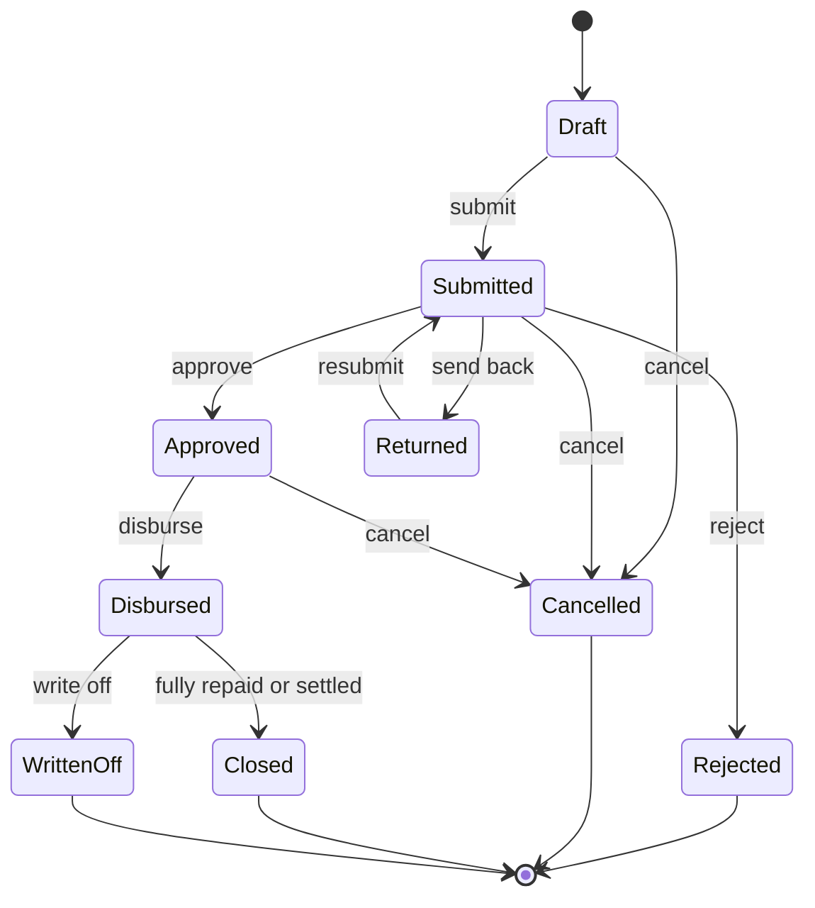
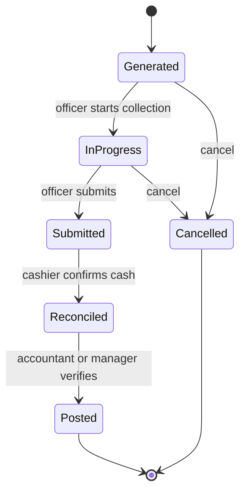
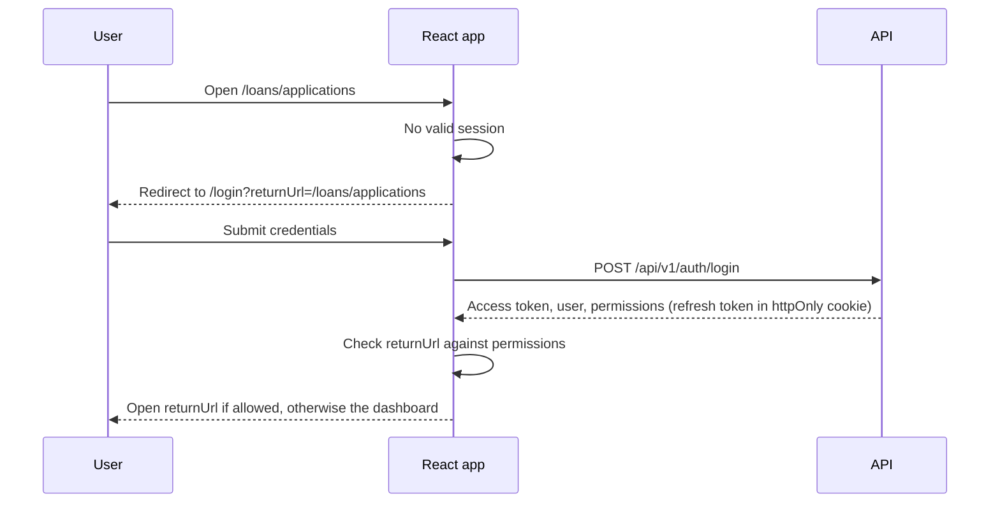
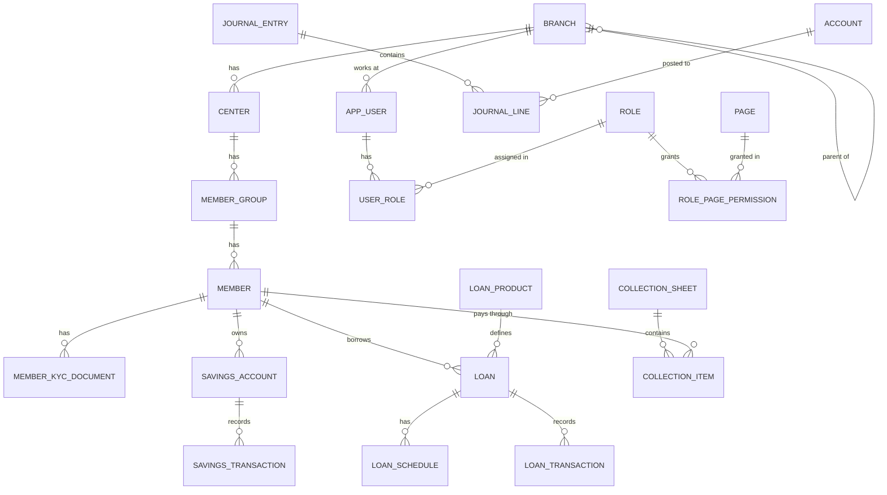

# Microfinance ERP

> A web-based ERP for running a microfinance institution (MFI) end to end: members, savings, loans, field collections, double-entry accounting, reporting, and a full audit trail. Backend on **ASP.NET Core**, client on **React**.

| | |
|---|---|
| **Status** | Early development; core workflows are being implemented, not production-ready |
| **Backend** | ASP.NET Core Web API (C#) |
| **Frontend** | React + TypeScript SPA |
| **Database** | PostgreSQL via EF Core and Npgsql |
| **Theme** | White and dark blue |
| **Last updated** | 2026-10-17 |

> **Placeholders to replace:** project name, repository URL, license, maintainers and contact details are marked with `TODO`.

### Local authentication configuration

The API requires a JWT signing secret and can create its first administrator at startup from environment variables. Provide these values through your local secret manager or shell environment; do not commit them:

| Variable | Required | Purpose |
|---|---|---|
| `Jwt__SigningKey` | Yes | Random signing secret of at least 32 bytes |
| `BootstrapAdmin__Email` | Optional | Initial administrator email |
| `BootstrapAdmin__Password` | With email | Initial password (at least 12 characters) |
| `BootstrapAdmin__FullName` | With email | Initial administrator's display name |

The bootstrap account is created only when its normalized email does not already exist. Login lockout starts after five failed attempts and lasts 15 minutes. Development client requests use the Vite `/api` proxy; set `VITE_API_PROXY_TARGET` when the API is not listening at `http://localhost:5143`. Access tokens are kept in memory and expire after 15 minutes.

For Docker Compose, also set `POSTGRES_PASSWORD` and `JWT_SIGNING_KEY` in the shell before starting the stack. Compose fails fast if either is missing; keep both out of source control.

### Implementation status (2026-10-17)

The README describes the intended version-1 system; it is not a claim that every listed feature is already implemented. The repository currently has initial authentication, member and loan API slices, and the savings account/transaction slice. Savings endpoints persist deposits and withdrawals, enforce minimum balances and member/account status rules, serialize balance changes, and require idempotency keys. Accounting posting is not yet wired to these transactions.

**Remaining work before production:**

- Complete authentication lifecycle: refresh/revocation, password reset/change, user and role administration, database-backed page/action permissions, and rate limiting.
- Implement branch hierarchy, authorized branch scoping, centers, groups, staff/field officers, and member profiles with KYC, document/photo storage, status history, paging, and audit.
- Complete savings products, account lifecycle, statements, reversal transactions, interest calculation/posting, maker-checker approval, and automatic balanced ledger entries.
- Replace the preliminary loan create endpoint with product-based applications, eligibility, approval workflow, disbursement, persisted schedules, repayments/allocation, overdue/PAR, settlement, rescheduling, write-off, and accounting postings.
- Replace collection mock data with generated sheets, item-level collection, submission, cash reconciliation, idempotent posting, reversals, and ledger integration.
- Implement a chart of accounts, fiscal periods, immutable journal entries, double-entry validation, voucher numbering, reconciliation, and real financial statements.
- Replace mock dashboard, report, audit, and settings data with persisted, branch-scoped data; add exports and compliance/audit trails.
- Finish the frontend route/permission model, modal workflows, accessible feedback, responsive data tables, and the remaining module screens.
- Add API integration and end-to-end tests for financial posting, idempotency, concurrency, authorization, and branch isolation; configure CI, dependency scanning, production migrations, structured logging/monitoring, backups, deployment, and recovery procedures.

---

## Table of Contents

1. [Project Overview](#1-project-overview)
2. [Business Background](#2-business-background)
3. [Scope and Goals](#3-scope-and-goals)
4. [Users and Roles](#4-users-and-roles)
5. [Technology Stack](#5-technology-stack)
6. [System Architecture](#6-system-architecture)
7. [Functional Modules](#7-functional-modules)
8. [Business Rules and Calculations](#8-business-rules-and-calculations)
9. [Accounting Design](#9-accounting-design)
10. [Workflows](#10-workflows)
11. [Access Control (RBAC) and Security](#11-access-control-rbac-and-security)
12. [Branch Data Isolation](#12-branch-data-isolation)
13. [Audit and Compliance](#13-audit-and-compliance)
14. [API Design](#14-api-design)
15. [Database Design](#15-database-design)
16. [Frontend Design](#16-frontend-design)
17. [UX Standards](#17-ux-standards)
18. [Getting Started](#18-getting-started)
19. [Configuration](#19-configuration)
20. [Testing](#20-testing)
21. [Deployment and Operations](#21-deployment-and-operations)
22. [Non-Functional Requirements](#22-non-functional-requirements)
23. [Roadmap](#23-roadmap)
24. [Development Conventions](#24-development-conventions)
25. [Glossary](#25-glossary)
26. [License and Contact](#26-license-and-contact)

---

## 1. Project Overview

Microfinance ERP replaces paper registers and spreadsheets with one system that an MFI can run its whole operation on. It covers the member lifecycle, savings products, loan products, door-to-door or center-based collections, the general ledger, management reports, and an audit trail that can stand up to an inspection.

### Highlights

- **Multi-branch with hierarchy.** Head office, regions, areas and branches, each user seeing only the branches they are allowed to see.
- **Role-based access down to the URL.** Every role lists exactly which pages (URLs) and actions (view, create, edit, delete, approve, export) it may use.
- **Login-first.** Any URL opened without a valid session redirects to the login page, then returns the user to where they were going.
- **Double-entry accounting built in.** Savings, loan and collection transactions post to the general ledger automatically.
- **Field-friendly collections.** Collection sheets are generated per center or group and reconciled against cash handed in.
- **Complete audit trail.** Who did what, when, from where, with before and after values.
- **Careful UX.** Create and edit forms open in popup dialogs, success and error messages appear at the top middle of the screen for 5 seconds, and the interface uses a clean white and dark blue theme.

---

## 2. Business Background

### 2.1 What microfinance is

Microfinance institutions provide small loans and basic financial services (savings, sometimes insurance) to people and small businesses that traditional banks usually do not serve. Loans are small, repaid in frequent short installments, and often rely on group trust instead of heavy collateral.

### 2.2 How a typical MFI operates

```
Head Office
  └── Region / Area
        └── Branch
              └── Center (a meeting place and schedule)
                    └── Group (a small set of members)
                          └── Member
```

- A **field officer** (loan officer) is responsible for one or more centers.
- Members meet at their center on a fixed day, usually weekly or bi-weekly. The field officer collects **loan installments** and **savings deposits** there.
- Many MFIs require **compulsory savings** alongside a loan.
- Loans run in **cycles**: a member who repays well becomes eligible for a larger amount next cycle.
- Collected cash is handed to the branch cashier, who reconciles it against the collection sheet, and the accountant posts it to the books.

### 2.3 Problems this system solves

| Problem with paper or spreadsheets | How the ERP addresses it |
|---|---|
| Calculation mistakes in interest and installments | One tested calculation engine, schedules generated by the system |
| Delayed or missing reconciliation | Collection sheets reconciled and posted to the ledger the same day |
| No real-time view of overdue loans | Live portfolio-at-risk (PAR) and overdue dashboards |
| Weak accountability | Immutable audit log of every important action |
| Data leaking between branches | Branch-level data isolation enforced in the backend |
| Slow month-end closing | Trial balance and financial statements at any time |

### 2.4 End-to-end business process



---

## 3. Scope and Goals

### 3.1 Goals

1. Give every branch a reliable daily operating tool for members, savings, loans and collections.
2. Give management accurate, timely financial and portfolio information.
3. Make every financial figure traceable to a transaction, and every transaction traceable to a person.
4. Keep the system simple enough for field and branch staff to use with minimal training.

### 3.2 In scope (version 1)

Authentication, Branches, Members, Savings, Loans, Collections, Accounting, Reports, Audit, Settings, plus the supporting modules in [section 7.11](#711-additional-recommended-modules): centers and groups, staff, products, dashboard, day-end closing, holiday calendar, and notifications.

### 3.3 Out of scope (version 1)

- Native mobile app for field officers
- Mobile wallet or payment gateway integration
- Credit bureau integration
- Payroll, HR and fixed-asset accounting
- Insurance product management

These are listed again in the [Roadmap](#23-roadmap).

---

## 4. Users and Roles

Roles are fully configurable. The table shows the **suggested default roles** that are seeded on first run.

| Role | Typical user | Typical access |
|---|---|---|
| Super Admin | System owner | Everything, including roles, users and system settings. Cannot be deleted. |
| Admin | Head office IT or operations | Users, roles, settings, all branches |
| Branch Manager | Branch head | Approvals, branch reports, branch staff, own branch only |
| Accountant | Branch or head office accountant | Chart of accounts, journals, reconciliation, financial reports |
| Cashier | Branch cashier | Receive collections, savings deposits and withdrawals, cash book |
| Field Officer | Loan officer | Own centers: members, collection sheets, loan applications |
| Auditor | Internal or external auditor | Read-only access to data, reports and audit logs |

> A user is assigned a role. The data model also allows multiple roles per user, in which case the effective permissions are the union of all assigned roles.

---

## 5. Technology Stack

### 5.1 Backend

| Concern | Choice |
|---|---|
| Framework | ASP.NET Core Web API on the current .NET LTS release (`net10.0`; change the target framework if you build on an older SDK) |
| Language | C# |
| ORM | Entity Framework Core (code-first migrations) |
| Database | SQL Server by default |
| Authentication | ASP.NET Core Identity for users and password hashing, JWT access tokens, rotating refresh tokens |
| Authorization | Custom permission-based policies (see [section 11](#11-access-control-rbac-and-security)) |
| Validation | FluentValidation |
| Mapping | Mapster or hand-written mappers |
| Logging | Serilog (console, file, optional Seq or Elastic) |
| API docs | Swagger / OpenAPI |
| Background jobs | Hangfire or Quartz.NET (interest posting, day-end, notifications) |
| Excel export | ClosedXML |
| PDF export | QuestPDF (check its license terms for your organization) |
| Testing | xUnit, FluentAssertions, Moq, Testcontainers or SQLite in-memory |

### 5.2 Frontend

| Concern | Choice |
|---|---|
| Library | React with TypeScript |
| Build tool | Vite |
| Routing | React Router |
| UI components | Ant Design (tables, forms, modals, messages) |
| Server state | TanStack Query |
| Client state | Zustand (auth session, permissions, UI preferences) |
| HTTP | Axios with request and response interceptors |
| Charts | Recharts or Ant Design Charts |
| Dates | dayjs |
| Testing | Vitest, React Testing Library, Playwright for end-to-end |

### 5.3 Infrastructure

| Concern | Choice |
|---|---|
| Containers | Docker and Docker Compose |
| Reverse proxy | Nginx, IIS or Caddy with HTTPS |
| File storage | Local disk behind an `IFileStorage` abstraction (swap for S3 or Azure Blob later) |
| CI/CD | GitHub Actions or Azure DevOps |

---

## 6. System Architecture

### 6.1 High-level view



### 6.2 Layers (Clean Architecture)

| Layer | Responsibility | Depends on |
|---|---|---|
| **Domain** | Entities, enums, value objects, domain rules (for example loan state transitions) | Nothing |
| **Application** | Use cases, DTOs, validators, interfaces (`ICurrentUser`, `IFileStorage`, `IClock`) | Domain |
| **Infrastructure** | EF Core `DbContext`, migrations, repositories, file storage, email and SMS, report generators | Application, Domain |
| **API** | Controllers, authentication, authorization handlers, exception middleware, `Program.cs` | Application, Infrastructure |

### 6.3 Solution structure

```
MicrofinanceErp/
├── src/
│   ├── MicrofinanceErp.Domain/
│   ├── MicrofinanceErp.Application/
│   ├── MicrofinanceErp.Infrastructure/
│   └── MicrofinanceErp.Api/
├── tests/
│   ├── MicrofinanceErp.Domain.Tests/
│   ├── MicrofinanceErp.Application.Tests/
│   └── MicrofinanceErp.Api.IntegrationTests/
├── client/                      # React application
├── docs/                        # Extra design notes, ER diagrams, screenshots
├── docker-compose.yml
└── README.md
```

### 6.4 Request lifecycle

1. The browser sends an HTTPS request with `Authorization: Bearer <access token>`.
2. Middleware assigns a **correlation id**, logs the request, and authenticates the token.
3. The permission handler checks that the user's role allows the requested action.
4. The controller calls an application service.
5. The service validates input, applies business rules, and uses the `DbContext`. A global query filter restricts every query to the user's accessible branches.
6. `SaveChanges` runs inside a transaction. An interceptor stamps audit fields and writes audit log rows.
7. The response is returned in the standard envelope (see [section 14](#14-api-design)), and the React app shows a toast for the message.

---

## 7. Functional Modules

Each module lists its features, key rules, and main screens. All create and edit forms open in a **popup dialog**; list and detail pages are normal routes.

### 7.1 Authentication

**Features**

- Login with username or email and password; logout
- Forgot password and reset password through an emailed, time-limited, single-use link
- Change password (requires the current password)
- Forced password change on first login and after an admin reset
- Role assignment to users, and role management with a permission matrix
- User management: create, edit, activate or deactivate, unlock, reset password

**Rules**

- Password policy is configurable (minimum length, upper and lower case, digit, symbol, history of the last N passwords, expiry in days).
- Account locks after a configurable number of failed attempts (default 5) for a configurable time (default 15 minutes).
- Logout revokes the refresh token on the server and clears the session in the browser, including other open tabs.
- Every login, failed login, logout, lockout and password change is audited.

**Screens**: `/login`, `/forgot-password`, `/reset-password`, `/change-password`, `/admin/users`, `/admin/roles`

### 7.2 Branches

**Features**

- Create and manage multiple branches
- Branch hierarchy: Head Office → Region → Area → Branch (a self-referencing tree)
- Tree view and list view; move a branch under a different parent
- Branch-specific data isolation (see [section 12](#12-branch-data-isolation))
- Branch switcher for users who can access more than one branch

| Field | Notes |
|---|---|
| Code | Unique, short, used in member and account numbers |
| Name | Required |
| Type | HeadOffice, Region, Area, Branch |
| Parent branch | Required except for the head office |
| Address, phone, email | Optional |
| Opening date | Used in reports |
| Branch manager | A staff member |
| Business date | The current working date of the branch (see day-end closing) |
| Status | Active or Inactive |

**Rules**

- A branch cannot be deactivated while it has active loans, open collection sheets, or unposted transactions.
- Branch code cannot change once transactions exist.

**Screens**: `/branches`

### 7.3 Members

**Features**

- Member registration with **photo upload**
- Member profile management
- Member status tracking: **Active**, **Inactive**, **Suspended**
- **KYC documentation**
- Assign a member to a center and group
- Member history: savings, loans, collections, status changes

| Field group | Fields |
|---|---|
| Identity | Member code (auto: `{BranchCode}-{sequence}`), full name, father's name, mother's name, spouse's name, date of birth, gender, marital status |
| Contact | Phone, alternate phone, email, present address, permanent address |
| Identification | National ID number, other ID numbers |
| Economic | Occupation, monthly income range, household size |
| Nominee | Name, relationship, phone, ID, share percentage |
| Membership | Branch, center, group, admission date, admission fee |
| Photo | JPG or PNG, size limit configurable (default 2 MB) |

**KYC documents**

- Document types are configurable: national ID, birth certificate, passport, driving license, utility bill, other
- Each document has: type, number, issue and expiry date, file upload, status (Pending, Verified, Rejected), verified by and when, rejection reason
- A member can be configured to require at least one verified identity document before a loan is approved

**Status rules (defaults, configurable in business rules)**

| Action | Active | Inactive | Suspended |
|---|---|---|---|
| New loan application | Allowed | Blocked | Blocked |
| Savings deposit | Allowed | Allowed | Blocked |
| Savings withdrawal | Allowed | Blocked | Blocked |
| Repayment of an existing loan | Allowed | Allowed | Allowed |

- Every status change needs a **reason** and is audited.
- Photos and documents are stored outside the public web root and served only through an authorized endpoint. File type is checked by content, not just by extension.

**Screens**: `/members`, `/members/:id`, `/members/kyc`

### 7.4 Savings

**Features**

- Create **individual** and **group** savings accounts
- Track savings transactions
- Generate savings reports and statements
- **Interest calculation** where the product pays interest

**Savings products** define: name, type (general, compulsory, and later fixed deposit or DPS), interest rate, interest method, posting frequency, minimum opening balance, minimum balance, withdrawal limits, and fees.

**Accounts**

- Account number is generated per branch (`{BranchCode}-{ProductCode}-{sequence}`).
- An **individual** account belongs to one member.
- A **group** account belongs to a group and keeps a member-wise contribution ledger.
- Status: Pending, Active, Dormant, Closed.

**Transactions**: Deposit, Withdrawal, Interest posting, Fee, Transfer (optional), Reversal.

**Rules**

- No overdraft: a withdrawal cannot exceed the available balance minus the minimum balance.
- Withdrawals above a configurable amount need approval (maker-checker).
- Posted transactions are never edited or deleted. A mistake is corrected with a **reversal** transaction that references the original.
- Interest method and posting frequency are set per product (see [section 8.2](#82-savings-interest)).

**Implemented API slice:** `GET/POST /api/v1/savings/accounts`, `GET /api/v1/savings/accounts/{id}/transactions`, and `POST /api/v1/savings/accounts/{id}/transactions` support individual account opening and deposit/withdrawal recording. Transaction posts require an `Idempotency-Key`, lock the account row while validating/updating its balance, and preserve an immutable transaction record. Product configuration, transaction reversals, approval and general-ledger posting are not implemented yet.

**Screens**: `/savings/products`, `/savings/accounts`, `/savings/transactions`

### 7.5 Loans

**Features**

- Loan application processing
- Loan approval and disbursement
- Payment tracking and collection
- Loan status monitoring
- Interest and principal calculation

**Loan products** define: name, interest method (flat or declining balance), annual interest rate, min and max amount, min and max term, installment frequency (weekly, bi-weekly, monthly), processing fee, insurance fee, grace period, penalty rules, required compulsory savings, and loan cycle limits.

**Application**

- Member, product, requested amount, term, installment frequency, purpose
- Guarantors and collateral (optional per product)
- Loan cycle number and previous loan history are shown automatically
- Eligibility checks run when the application is submitted:
  - Member is Active and KYC requirement is met
  - No overdue installments on any other loan
  - Within the maximum number of concurrent loans
  - Requested amount within the cycle limit for that member
  - Required savings balance is met

**Approval**

- Approval levels depend on the loan amount (for example Branch Manager up to a limit, Area or Region above it). Limits are set in business rules.
- The approver can approve, reject, or send back with a comment. Approved amount may be lower than requested.

**Disbursement**

- Channel: cash, bank, or transfer to the member's savings account
- Fees and insurance can be deducted at disbursement or charged separately
- The system generates the repayment schedule and posts the accounting entry automatically

**Lifecycle after disbursement**

- **Repayment** and **early settlement**
- **Rescheduling** (new schedule, old schedule kept in history)
- **Write-off** and later **recovery**
- **Closure** when the outstanding balance reaches zero

**Statuses**: Draft, Submitted, Returned, Approved, Rejected, Disbursed (Active), Closed, WrittenOff, Cancelled. *Overdue* is a calculated flag, not a status.

**Screens**: `/loans/products`, `/loans/applications`, `/loans/disbursements`, `/loans/portfolio`, `/loans/repayments`

### 7.6 Collections

**Features**

- Create collection sheets
- Track payments from members
- Generate collection reports
- Payment reconciliation

**How it works**

1. The system **generates a collection sheet** for a center (or group), a collection date, and a field officer. It lists every member with the loan installment due, any overdue amount, and the savings amount expected.
2. The field officer collects money at the meeting and records the **amount actually collected** per member (full, partial, or none, with a reason).
3. The sheet is **submitted**. The cashier receives the cash and enters the **cash received**.
4. The system compares collected against received and records any **shortage or excess**.
5. The accountant or branch manager **verifies** the sheet. On verification, repayments and savings deposits are posted and the ledger entry is created.

**Sheet statuses**: Generated, InProgress, Submitted, Reconciled, Posted, Cancelled.

**Rules**

- A payment allocation follows the configured order (default: penalty, fees, interest, principal). See [section 8.4](#84-repayment-allocation).
- Double submission is prevented with an idempotency key, so a slow network or double click cannot post a payment twice.
- A posted sheet is locked. Corrections use reversal entries.

**Screens**: `/collections/sheets`, `/collections/reconciliation`

### 7.7 Accounting

**Features**

- Chart of accounts management
- Journal entry creation
- Double-entry bookkeeping
- Account reconciliation
- Trial balance

**Chart of accounts**

- Hierarchical, with account types: Asset, Liability, Equity, Income, Expense
- Each account has a code, name, parent, type, normal balance (debit or credit), and whether it allows direct posting
- **System accounts** (for example Cash in Hand, Loans to Members, Member Savings, Interest Income) are mapped in settings so automatic postings know where to post

**Journal entries**

- Manual vouchers: journal, cash, bank (separate voucher number series)
- Automatic entries from savings, loans and collections
- Each entry has a date, narration, reference to its source transaction, and two or more lines
- **An entry cannot be saved unless total debits equal total credits**
- Posted entries are immutable. Corrections use a reversing entry.
- Manual entries can require approval before posting

**Reconciliation**

- Cash book against physical cash count
- Bank accounts against bank statements
- Subledger to ledger: total of all loan balances equals the *Loans to Members* account, total of all savings balances equals the *Member Savings* account

**Trial balance**

- For a date or date range, by branch or consolidated for the head office
- Shows opening, debit, credit and closing columns, and a check that total debits equal total credits
- Drill down from an account to its journal lines

**Fiscal year and periods**: a fiscal year contains periods (months). A closed period rejects new postings.

**Screens**: `/accounting/chart-of-accounts`, `/accounting/journal-entries`, `/accounting/reconciliation`, `/accounting/trial-balance`, `/accounting/fiscal-years`

### 7.8 Reports

All reports support filters (branch, center, field officer, date range, status), on-screen view, and **export to Excel and PDF**. Large exports run as background jobs and are downloaded when ready.

| Group | Reports |
|---|---|
| Member | Member list, new members, status summary, KYC pending or expired, member statement |
| Savings | Account list, transaction register, balance summary, interest posted, dormant accounts |
| Loan | Disbursement register, outstanding loans, overdue loans, portfolio at risk (PAR), loan aging, loan statement, write-offs, repayment schedule |
| Collection | Collection sheet, daily collection summary, collector performance, collection efficiency, shortage and excess |
| Financial | Trial balance, general ledger, cash book, income statement, balance sheet, receipts and payments |

**Screens**: `/reports/members`, `/reports/savings`, `/reports/loans`, `/reports/collections`, `/reports/financial`

### 7.9 Audit

**Features**

- User activity logging
- System event tracking
- Audit trail generation (who changed what, with before and after values)
- Compliance reporting
- Activity dashboard

Details are in [section 13](#13-audit-and-compliance).

**Screens**: `/audit/logs`, `/audit/events`, `/audit/trail`, `/audit/compliance`, `/audit/dashboard`

### 7.10 Settings

| Group | What it controls |
|---|---|
| **System configuration** | Application name and logo, currency and number format, date format, time zone, fiscal year start, password policy, session timeout, file upload limits, email and SMS gateway |
| **Organization settings** | Legal name, registration number, address, contacts, logo for reports and receipts, regulator details |
| **User preferences** | Per-user: language, default page size, default landing page, date format |
| **Business rules configuration** | Loan and savings limits, approval limits, penalty rules, repayment allocation order, PAR thresholds, member status rules, collection rules, rounding rules |

Changes to settings are audited with old and new values.

**Screens**: `/settings/system`, `/settings/organization`, `/settings/business-rules`, `/settings/preferences`

### 7.11 Additional recommended modules

These were not in the original list but a working MFI needs them.

| Module | Purpose |
|---|---|
| **Centers and Groups** | The meeting structure members belong to; each center has a meeting day, time, location and assigned field officer |
| **Staff and Field Officers** | Employee records linked to user accounts; portfolio assignment by center |
| **Product management** | Savings products, loan products, fee and penalty definitions |
| **Dashboard** | Role-specific summary: active members, savings balance, loans outstanding, today's collection, overdue amount, PAR, pending approvals |
| **Day-end closing** | Locks a branch's transactions for a business date after all collection sheets are posted and cash is balanced; reopening needs a special permission and is audited |
| **Maker-checker approvals** | A generic approval queue for sensitive actions (large withdrawals, manual journals, write-offs, reversals) |
| **Holiday calendar** | Skips non-working days when generating repayment schedules and collection sheets |
| **Notifications** | Email and SMS reminders for upcoming installments, overdue loans, and approvals waiting |
| **Bulk import** | Excel import for members and opening balances, with a validation report |
| **Cash and bank management** | Cash book, bank accounts, cash transfers between branch and head office |
| **Backup and restore** | Scheduled database backup with retention, documented restore procedure |

---

## 8. Business Rules and Calculations

Every value below is a **default**. Rates, limits, thresholds and orders are stored in Settings → Business Rules, not hard-coded.

### 8.1 Loan interest methods

Let `P` be the principal, `R` the annual interest rate, `n` the number of installments, and `k` the number of installments per year (weekly 52, bi-weekly 26, monthly 12).

**Flat rate**

```
Total interest   = P × R × (n / k)
Total repayable  = P + Total interest
Installment      = Total repayable / n
Principal part   = P / n          (per installment)
Interest part    = Total interest / n
```

**Declining balance (equal installments)**

```
r            = R / k                              (rate per period)
Installment  = P × r × (1 + r)^n / ((1 + r)^n − 1)
Interest_t   = Opening balance_t × r
Principal_t  = Installment − Interest_t
Closing_t    = Opening balance_t − Principal_t
```

**Worked example**: `P = 50,000`, `R = 24%`, 12 monthly installments.

| Method | Installment | Total interest | Total repayable |
|---|---|---|---|
| Flat | 5,166.67 (last one 5,166.63) | 12,000.00 | 62,000.00 |
| Declining balance | 4,727.98 | about 6,735.76 | about 56,735.76 |

For the declining balance case, `r = 0.02`, so the first month's interest is `50,000 × 0.02 = 1,000.00` and the first principal part is `3,727.98`.

> A flat rate and a declining rate with the same percentage are **not** the same cost to the member. The loan screen shows the **effective rate** so the member and officer can compare products honestly.

**Schedule generation rules**

- First due date = disbursement date + one installment period (or the product's grace period).
- If a due date falls on a holiday or non-working day, it moves to the next working day (setting: next, previous, or keep).
- The **last installment absorbs any rounding difference**, so the schedule always adds up exactly to principal plus interest.
- A schedule is stored row by row (due date, principal, interest, fees, total) and never recalculated silently. Rescheduling creates a new schedule version and keeps the old one.

### 8.2 Savings interest

- **Daily balance method** (default): `Interest = Σ (end-of-day balance × annual rate / 365)` over the posting period.
- Alternative per product: minimum balance in the period.
- Posting frequency per product: monthly, quarterly, half-yearly, or yearly, by a background job.
- Optional withholding tax percentage, posted to a tax payable account.
- Dormant and closed accounts do not earn interest unless the product says otherwise.

### 8.3 Penalties and fees

| Item | Default behaviour |
|---|---|
| Late penalty | Charged on overdue installment amount, either a fixed amount or a percentage per day or per week, after a grace period |
| Penalty cap | Maximum as a percentage of the overdue amount or loan principal |
| Processing fee | Percentage or fixed, at disbursement |
| Insurance fee | Percentage or fixed, at disbursement |
| Early settlement | Optional fee; interest treatment (full, pro-rata, or unearned waived) set per product |
| Waiver | Needs a dedicated permission and a mandatory reason; fully audited |

### 8.4 Repayment allocation

Default order for any payment received on a loan:

1. Penalty
2. Fees
3. Interest due
4. Principal due
5. Advance (paid ahead of schedule)

Overdue installments are settled oldest first. Any amount above what is outstanding is handled by setting: refunded, or moved to the member's savings account.

### 8.5 Portfolio at risk and classification

```
PAR(x) = Outstanding principal of loans overdue more than x days
         ÷ Total outstanding principal  × 100
```

PAR 1, PAR 30 and PAR 90 are shown on the dashboard.

Loan classification uses days overdue. The table shows **example defaults only**. Align the thresholds and provisioning rates with the rules of your own regulator before going live.

| Class | Days overdue (example) | Provision (example) |
|---|---|---|
| Regular | 0 | 1% |
| Watchlist | 1 to 29 | 5% |
| Substandard | 30 to 59 | 25% |
| Doubtful | 60 to 89 | 50% |
| Bad / Loss | 90 and above | 100% |

### 8.6 Loan cycle and limits

- Maximum loan amount rises per cycle, defined per product (for example cycle 1 up to X, cycle 2 up to Y).
- Maximum number of concurrent active loans per member.
- Optional required compulsory savings, as a percentage of the loan.
- Approval limits per role or branch level.

### 8.7 Money and rounding

- All money is `decimal(18,2)`. Rates are `decimal(9,4)`. **Never use floating point for money.**
- Rounding: half away from zero (`MidpointRounding.AwayFromZero`) to 2 decimals, applied at the line level.
- Currency code and symbol come from Settings. Single currency in version 1.
- All timestamps are stored in UTC. Business dates (a date without time) are stored as `date`.

---

## 9. Accounting Design

### 9.1 Principles

- Strict **double entry**: every journal entry balances, enforced in code and by a database check.
- **Immutable ledger**: posted entries are never edited or deleted. Corrections are reversal entries that reference the original.
- **Subledger-driven**: loans, savings and collections are the source of truth for their balances; the ledger is updated through automatic postings, and a reconciliation report proves they agree.
- **Periods**: posting into a closed period is rejected.

### 9.2 Automatic posting rules

Account names are system-mapped in Settings, so each institution can use its own chart of accounts.

| Event | Debit | Credit |
|---|---|---|
| Savings deposit | Cash in Hand (or Bank) | Member Savings (liability) |
| Savings withdrawal | Member Savings | Cash in Hand (or Bank) |
| Savings interest posted | Interest Expense on Savings | Member Savings |
| Loan disbursement (principal) | Loans to Members (asset) | Cash in Hand, Bank, or Member Savings |
| Processing fee at disbursement | Cash in Hand (or deducted from disbursement) | Fee Income |
| Installment collected: principal part | Cash in Hand | Loans to Members |
| Installment collected: interest part | Cash in Hand | Interest Income on Loans |
| Penalty collected | Cash in Hand | Penalty Income |
| Interest accrual (optional) | Interest Receivable | Interest Income on Loans |
| Provision for loan loss | Provision Expense | Loan Loss Provision |
| Loan write-off | Loan Loss Provision (or Bad Debt Expense) | Loans to Members |
| Recovery of written-off loan | Cash in Hand | Recovery of Written-off Loans |
| Cash shortage found at reconciliation | Cash Shortage (expense or receivable from staff) | Cash in Hand |

Interest income recognition is configurable. **Default: when collected.** Accrual is available as an option.

### 9.3 Example entries

**Disbursement of 50,000 with a 1% processing fee deducted**

| Account | Debit | Credit |
|---|---|---|
| Loans to Members | 50,000.00 | |
| Cash in Hand | | 49,500.00 |
| Fee Income | | 500.00 |

**One flat-rate installment collected (principal 4,166.67 and interest 1,000.00)**

| Account | Debit | Credit |
|---|---|---|
| Cash in Hand | 5,166.67 | |
| Loans to Members | | 4,166.67 |
| Interest Income on Loans | | 1,000.00 |

### 9.4 Voucher numbering

Series per branch, per fiscal year, and per type, for example `JV-2026-BR01-000123` for a journal voucher. Numbers are gap-free per series and assigned at posting time.

### 9.5 Reconciliation checks

| Check | Rule |
|---|---|
| Loans | Sum of all loan outstanding principal = *Loans to Members* ledger balance |
| Savings | Sum of all savings account balances = *Member Savings* ledger balance |
| Cash | Cash book closing balance = physical cash counted |
| Bank | Ledger bank balance matches the statement after listing unreconciled items |
| Trial balance | Total debits = total credits |

---

## 10. Workflows

### 10.1 Loan lifecycle



`Disbursed` is shown to users as **Active**. *Overdue* is calculated from the schedule and the current business date.

### 10.2 Collection sheet lifecycle



### 10.3 Login and redirect flow



### 10.4 Day-end closing

1. All collection sheets for the business date are Posted or Cancelled.
2. Pending approvals for the date are cleared or carried over with a note.
3. Cashier cash count equals the cash book balance, or the difference is explained.
4. The manager closes the day. The branch business date moves forward and the date's transactions are locked.
5. Reopening a closed day needs a special permission, a reason, and is audited.

---

## 11. Access Control (RBAC) and Security

### 11.1 The requirement

- Each **role** lists which **pages (URLs)** it can open and which **actions** it can perform on each page.
- Each **user** is assigned a role.
- Opening any protected URL **without being logged in redirects to the login page**.
- Opening a URL the role does not allow shows a **403 Forbidden** page, and the API rejects the matching calls.

### 11.2 Data model

| Table | Purpose | Key columns |
|---|---|---|
| `Users` (ASP.NET Core Identity, extended) | Accounts | FullName, BranchId, StaffId, IsActive, MustChangePassword, PasswordChangedAt, LastLoginAt |
| `Roles` | Role definitions | Name, Description, IsSystem, IsActive |
| `UserRoles` | Role assigned to user | UserId, RoleId |
| `UserBranches` | Extra branches a user may access | UserId, BranchId, IsDefault |
| `Pages` | Every screen in the app | Code, Name, Module, **Url**, ParentId, DisplayOrder, Icon, ShowInMenu |
| `RolePagePermissions` | What a role may do on a page | RoleId, PageId, CanView, CanCreate, CanEdit, CanDelete, CanApprove, CanExport |
| `RefreshTokens` | Rotating refresh tokens (stored hashed) | UserId, TokenHash, ExpiresAt, RevokedAt, ReplacedByTokenHash, CreatedByIp |

`Pages` is **seeded by the application** from a single source of truth in code, so a new screen cannot be shipped without a permission entry.

### 11.3 Permission codes

A permission is `Module.Page.Action`, for example:

```
Members.Members.View
Loans.Applications.Create
Loans.Applications.Approve
Accounting.JournalEntries.Edit
Reports.Loans.Export
Admin.Roles.Edit
```

A role's **allowed URLs** are the pages where `CanView = true`. The other flags control buttons and API actions.

### 11.4 Page registry (seeded)

| Module | Page code | URL |
|---|---|---|
| Dashboard | Dashboard | `/dashboard` |
| Branches | Branches | `/branches` |
| Centers | Centers, Groups | `/centers`, `/groups` |
| Members | Members, MemberKyc | `/members`, `/members/kyc` |
| Savings | SavingsProducts, SavingsAccounts, SavingsTransactions | `/savings/products`, `/savings/accounts`, `/savings/transactions` |
| Loans | LoanProducts, Applications, Disbursements, Portfolio, Repayments | `/loans/products`, `/loans/applications`, `/loans/disbursements`, `/loans/portfolio`, `/loans/repayments` |
| Collections | CollectionSheets, Reconciliation | `/collections/sheets`, `/collections/reconciliation` |
| Accounting | ChartOfAccounts, JournalEntries, Reconciliation, TrialBalance, FiscalYears | `/accounting/chart-of-accounts`, `/accounting/journal-entries`, `/accounting/reconciliation`, `/accounting/trial-balance`, `/accounting/fiscal-years` |
| Reports | Members, Savings, Loans, Collections, Financial | `/reports/members`, `/reports/savings`, `/reports/loans`, `/reports/collections`, `/reports/financial` |
| Audit | Logs, Events, Trail, Compliance, Dashboard | `/audit/logs`, `/audit/events`, `/audit/trail`, `/audit/compliance`, `/audit/dashboard` |
| Settings | System, Organization, BusinessRules | `/settings/system`, `/settings/organization`, `/settings/business-rules` |
| Admin | Users, Roles | `/admin/users`, `/admin/roles` |

Detail routes such as `/members/:id` use the permission of their parent page. `/settings/preferences`, `/change-password` and `/403` are open to every logged-in user.

### 11.5 Backend enforcement

The API is the real gatekeeper. The React app only hides what a user cannot use.

```csharp
[ApiController]
[Route("api/v1/loans/applications")]
[Authorize]
public class LoanApplicationsController : ControllerBase
{
    [HttpGet]
    [HasPermission("Loans.Applications.View")]
    public async Task<IActionResult> List([FromQuery] LoanApplicationQuery query)
        => Ok(await _service.ListAsync(query));

    [HttpPost("{id:long}/approve")]
    [HasPermission("Loans.Applications.Approve")]
    public async Task<IActionResult> Approve(long id, ApproveLoanRequest request)
        => Ok(await _service.ApproveAsync(id, request));
}
```

`HasPermissionAttribute` derives from `AuthorizeAttribute` and sets a policy name from the permission code. A custom `IAuthorizationPolicyProvider` builds the policy on demand, and a `PermissionHandler` asks `IPermissionService` whether the current user's role holds the permission.

- Permissions are **read from the database and cached** (invalidated when a role changes), not trusted from the JWT. A role change takes effect immediately, without waiting for the token to expire.
- The JWT carries only the user id, role ids, and the default branch id.

### 11.6 Session and token handling

| Item | Design |
|---|---|
| Access token | JWT, short lifetime (default 15 minutes), kept **in memory** in the browser |
| Refresh token | Random value, long lifetime (default 7 days), stored **hashed** in the database, sent as an `httpOnly`, `Secure`, `SameSite=Strict` cookie |
| Rotation | Every refresh issues a new refresh token and revokes the old one. Reuse of a revoked token revokes the whole token family. |
| Logout | Revokes the refresh token on the server, clears client state, notifies other tabs |
| Session timeout | Idle timeout from Settings; the user is warned shortly before being logged out |
| Expired session | One automatic refresh attempt; if it fails the user is redirected to `/login?returnUrl=...` with a message |

### 11.7 Security checklist

| Area | Control |
|---|---|
| Passwords | Hashed with the ASP.NET Core Identity password hasher (PBKDF2). Policy, history, lockout and expiry configurable. |
| Transport | HTTPS only, HSTS, secure cookies |
| Brute force | Lockout plus rate limiting on login, forgot-password and refresh endpoints |
| Input | Server-side validation on every request; EF Core parameterized queries only |
| XSS | React escapes by default; no `dangerouslySetInnerHTML`; a restrictive Content Security Policy |
| CSRF | Access token in the `Authorization` header; refresh cookie is `SameSite=Strict` and the refresh endpoint also requires a custom header |
| CORS | Explicit allow-list of origins, no wildcard |
| File uploads | Size limit, content-type check by file signature, random stored file name, stored outside the web root, served through an authorized endpoint |
| Secrets | Never in source control: `dotnet user-secrets` locally, environment variables or a secret manager in production |
| Personal data | National ID and phone masked in list views; full value only with a dedicated permission; optional encryption at rest |
| Database | Application account with least privilege; the audit table allows insert and select only |
| Errors | Global exception middleware returns a safe message and a `traceId`; stack traces only in logs |
| Dependencies | Dependency and vulnerability scanning in CI |
| Reference | OWASP ASVS and OWASP Top 10 used as review checklists |

---

## 12. Branch Data Isolation

A user must never see or change another branch's data unless their role and branch access allow it.

### 12.1 Hierarchy

`Branches` is a tree (`ParentBranchId`). Each row also stores a `HierarchyPath` such as `/1/4/9/` (ids from the root down). A user's **accessible branches** are every branch whose path starts with their own branch's path, plus anything in `UserBranches`.

| User at | Can see |
|---|---|
| Head Office | Every branch |
| Region | The region and all areas and branches under it |
| Area | The area and its branches |
| Branch | Only that branch |

### 12.2 How it is enforced

1. Every branch-owned entity implements `IBranchScoped` (it has a `BranchId`).
2. `ICurrentUser` exposes `CanAccessAllBranches` and `AccessibleBranchIds`, resolved once per request.
3. EF Core **global query filters** apply automatically to every query, including reports and joins:

```csharp
modelBuilder.Entity<Member>().HasQueryFilter(m =>
    _currentUser.CanAccessAllBranches ||
    _currentUser.AccessibleBranchIds.Contains(m.BranchId));
```

4. On create and update, the service checks that the target `BranchId` is inside the user's accessible set. A forged `branchId` in a request is rejected with 403.
5. The branch switcher sends the chosen branch in an `X-Branch-Id` header, which is validated against the accessible set on every request.
6. `IgnoreQueryFilters()` is allowed only in a few reviewed system services (for example day-end jobs), and each use is covered by a test.
7. Automated tests prove isolation: a user in branch A cannot read, update, or even detect (by id) a record in branch B.

---

## 13. Audit and Compliance

### 13.1 What is recorded

| Category | Examples |
|---|---|
| Authentication | Login, failed login, logout, lockout, password change and reset |
| Data changes | Create, update, delete (soft) on every business entity, with old and new values |
| Financial actions | Disbursement, repayment, reversal, write-off, waiver, journal posting, day-end close and reopen |
| Approvals | Submitted, approved, rejected, returned, with comments |
| Administration | Role and permission changes, user creation and deactivation, settings changes |
| Sensitive reads | Viewing or exporting full National ID, exporting large reports |
| System events | Unhandled errors, background job runs and failures, failed integrations, configuration changes |

### 13.2 Audit log record

| Column | Description |
|---|---|
| Id | Identity |
| TimestampUtc | When it happened |
| UserId, UserName, RoleName | Who |
| BranchId | Branch context |
| Action | Create, Update, Delete, Login, Approve, and so on |
| EntityName, EntityId | What |
| OldValues, NewValues | JSON of changed fields only |
| IpAddress, UserAgent | From where |
| CorrelationId | Ties the entry to the request and to log files |
| Remarks | Reason text where required (status changes, waivers, reopen day) |

### 13.3 How it is implemented

- An EF Core `SaveChanges` **interceptor** writes data-change entries in the same transaction as the change, so a change can never be saved without its audit record.
- Explicit audit calls cover non-database events (login, export, approvals).
- The audit table is **append-only**. The application database account has no update or delete right on it.
- Secrets and password hashes are never written to the log.
- Retention is configurable (default: keep for the legal minimum of your jurisdiction, archive older rows).

### 13.4 Screens and reports

- **Audit logs**: search by user, date range, action, entity, branch, IP
- **Audit trail**: the full history of one record (for example one loan), newest to oldest, with field-level differences
- **System events**: errors and job runs
- **Compliance reports**: user access review (who has which role), role change history, privileged action report, failed login report, reopened days and reversals report, KYC completeness
- **Activity dashboard**: logins per day, failed logins, top actions, most active users, recent sensitive actions, unusual activity (for example after-hours approvals)

---

## 14. API Design

### 14.1 Conventions

- Base path: `/api/v1`, JSON over HTTPS, documented with Swagger at `/swagger` in non-production.
- Resource names are plural and lowercase: `/members`, `/loans/applications`.
- Dates use ISO 8601. Timestamps are UTC (`2026-10-12T08:30:00Z`). Business dates are `YYYY-MM-DD`.
- Money is a JSON number with two decimals; all calculation happens on the server.
- List endpoints accept `page`, `pageSize`, `search`, `sort` (for example `-createdAt`) and module-specific filters.
- Updates use a `rowVersion` value. If the record changed meanwhile the API returns **409 Conflict** and the UI tells the user to reload.
- Payment and posting endpoints require an `Idempotency-Key` header so retries cannot double-post.

### 14.2 Standard response

**Success**

```json
{
  "success": true,
  "message": "Member saved successfully.",
  "data": { "id": 1024, "code": "BR01-000123" },
  "errors": null,
  "traceId": "00-4bf92f3577b34da6a3ce929d0e0e4736-00"
}
```

**Validation error**

```json
{
  "success": false,
  "message": "Please correct the highlighted fields.",
  "data": null,
  "errors": { "phone": ["This phone number is already registered."] },
  "traceId": "00-4bf92f3577b34da6a3ce929d0e0e4736-00"
}
```

The React app shows `message` in the top-middle toast and maps `errors` onto the matching form fields.

**Paged list** (`data` for list endpoints)

```json
{
  "items": [],
  "page": 1,
  "pageSize": 20,
  "totalCount": 134,
  "totalPages": 7
}
```

### 14.3 Status codes

| Code | Meaning | Client behaviour |
|---|---|---|
| 200 / 201 | Success / created | Success toast, refresh list |
| 400 | Validation or business rule failed | Error toast, field errors on the form |
| 401 | Not logged in or token expired | Try refresh once, else redirect to login |
| 403 | Logged in but not permitted | Error toast or `/403` page |
| 404 | Not found (also used for out-of-branch records) | Not-found message |
| 409 | Concurrency conflict or duplicate | Error toast asking the user to reload |
| 422 | Semantic error (for example a closed period) | Error toast |
| 429 | Rate limited | Error toast with retry advice |
| 500 | Unexpected error | Generic error toast with the `traceId` |

### 14.4 Endpoint catalog (main resources)

| Module | Endpoints |
|---|---|
| Auth | `POST /auth/login`, `POST /auth/logout`, `POST /auth/refresh`, `GET /auth/me`, `POST /auth/change-password`, `POST /auth/forgot-password`, `POST /auth/reset-password` |
| Users and roles | `GET/POST /users`, `GET/PUT /users/{id}`, `PUT /users/{id}/role`, `PUT /users/{id}/status`, `POST /users/{id}/reset-password`, `GET/POST /roles`, `PUT/DELETE /roles/{id}`, `GET /pages`, `GET/PUT /roles/{id}/permissions` |
| Branches | `GET/POST /branches`, `GET /branches/tree`, `GET/PUT /branches/{id}`, `PUT /branches/{id}/status`, `PUT /branches/{id}/parent` |
| Members | `GET/POST /members`, `GET/PUT /members/{id}`, `PUT /members/{id}/status`, `POST/GET /members/{id}/photo`, `GET/POST /members/{id}/kyc`, `PUT /members/{id}/kyc/{docId}/verify` |
| Savings | `GET/POST /savings/products`, `GET/POST /savings/accounts`, `GET /savings/accounts/{id}/statement`, `GET/POST /savings/transactions`, `POST /savings/transactions/{id}/reverse` |
| Loans | `GET/POST /loans/products`, `GET/POST /loans/applications`, `POST /loans/applications/{id}/submit`, `.../approve`, `.../reject`, `.../return`, `POST /loans/{id}/disburse`, `GET /loans/{id}/schedule`, `POST /loans/{id}/repayments`, `POST /loans/{id}/reschedule`, `POST /loans/{id}/settle`, `POST /loans/{id}/write-off` |
| Collections | `POST /collections/sheets/generate`, `GET /collections/sheets`, `GET/PUT /collections/sheets/{id}`, `POST .../submit`, `POST .../reconcile`, `POST .../post` |
| Accounting | `GET/POST /accounting/accounts`, `GET/POST /accounting/journal-entries`, `POST /accounting/journal-entries/{id}/post`, `POST .../reverse`, `GET /accounting/trial-balance`, `GET /accounting/reconciliation/{type}`, `GET/POST /accounting/fiscal-years` |
| Reports | `GET /reports/{code}?format=json\|xlsx\|pdf` |
| Audit | `GET /audit/logs`, `GET /audit/trail/{entity}/{id}`, `GET /audit/events`, `GET /audit/dashboard`, `GET /audit/compliance/{report}` |
| Settings | `GET/PUT /settings/system`, `/settings/organization`, `/settings/business-rules`, `/settings/preferences` |

---

## 15. Database Design

### 15.1 Conventions

- Primary keys: `bigint` identity, plus a human-readable unique **code** (member code, account number, loan number, voucher number) where users need one.
- Every business table has audit columns: `CreatedAtUtc`, `CreatedBy`, `UpdatedAtUtc`, `UpdatedBy`.
- Business tables use **soft delete** (`IsDeleted`, `DeletedAtUtc`, `DeletedBy`). Ledger, transaction and audit tables are never deleted at all.
- `RowVersion` concurrency token on editable tables.
- Branch-owned tables carry a `BranchId` and an index that starts with it.
- Money `decimal(18,2)`, rates `decimal(9,4)`, enums stored as short strings or small ints with a lookup.
- Check constraints: journal line has either a debit or a credit (not both); status values are valid; amounts are not negative.

### 15.2 Tables by module

| Module | Main tables |
|---|---|
| Identity and access | Users, Roles, UserRoles, UserBranches, Pages, RolePagePermissions, RefreshTokens, PasswordHistory |
| Organization | Branches, Centers, Groups, Staff, HolidayCalendar |
| Members | Members, MemberNominees, MemberKycDocuments, MemberStatusHistory |
| Savings | SavingsProducts, SavingsAccounts, SavingsAccountMembers (group contributions), SavingsTransactions, SavingsInterestPostings |
| Loans | LoanProducts, LoanApplications, LoanGuarantors, LoanCollaterals, LoanApprovals, Loans, LoanSchedules (versioned), LoanTransactions, LoanPenalties, LoanWriteOffs |
| Collections | CollectionSheets, CollectionSheetItems, CashReceipts |
| Accounting | Accounts, AccountMappings, FiscalYears, FiscalPeriods, JournalEntries, JournalLines, VoucherSequences, Reconciliations |
| Approvals | ApprovalRequests, ApprovalSteps |
| Audit | AuditLogs, SystemEvents |
| Settings | SystemSettings, OrganizationProfile, BusinessRules, UserPreferences, Notifications, NotificationTemplates |

### 15.3 Core relationships



### 15.4 Important indexes and constraints

- Unique: member code, savings account number, loan number, voucher number per series, branch code, role name, page code.
- Unique: one active national ID per branch group (configurable).
- Index on `(BranchId, Status)` for members, loans and collection sheets.
- Index on `(LoanId, DueDate)` for schedules, and `(DueDate, Status)` for overdue lookups.
- Index on `(AccountId, JournalDate)` for ledger and trial balance queries.
- Index on `(EntityName, EntityId)` and `(UserId, TimestampUtc)` for audit searches.

---

## 16. Frontend Design

### 16.1 Folder structure

```
client/
├── src/
│   ├── app/                 # App shell, providers (Query, Router, Theme)
│   ├── routes/              # Route registry, ProtectedRoute, PermissionRoute
│   ├── layouts/             # AppLayout (sidebar, header), AuthLayout
│   ├── features/
│   │   ├── auth/            # login, forgot/reset password, session store
│   │   ├── admin/           # users, roles, permission matrix
│   │   ├── branches/
│   │   ├── members/
│   │   ├── savings/
│   │   ├── loans/
│   │   ├── collections/
│   │   ├── accounting/
│   │   ├── reports/
│   │   ├── audit/
│   │   └── settings/
│   │       (each feature: api/, components/, pages/, types/, hooks/)
│   ├── shared/
│   │   ├── components/      # FormModal, DataTable, ConfirmDialog, PageHeader, StatusTag, Can
│   │   ├── hooks/           # usePermissions, useDebounce, useUnsavedChanges
│   │   ├── lib/             # axios instance, notify, formatters (money, date)
│   │   └── i18n/
│   ├── theme/               # Ant Design theme tokens, CSS variables
│   └── main.tsx
├── .env.example
└── package.json
```

### 16.2 Login-first routing and the redirect rule

Every route except the public auth pages sits behind `ProtectedRoute`. Without a valid session the user is sent to `/login`, with the original address kept in `returnUrl`.

```tsx
// routes/ProtectedRoute.tsx
export function ProtectedRoute() {
  const { isAuthenticated, isBootstrapping } = useAuth();
  const location = useLocation();

  if (isBootstrapping) return <FullPageSpinner />;       // trying silent refresh on page load

  if (!isAuthenticated) {
    const returnUrl = encodeURIComponent(location.pathname + location.search);
    return <Navigate to={`/login?returnUrl=${returnUrl}`} replace />;
  }
  return <Outlet />;
}

// routes/PermissionRoute.tsx
export function PermissionRoute({ page }: { page: string }) {
  const { can } = usePermissions();
  return can(page, 'view') ? <Outlet /> : <Navigate to="/403" replace />;
}
```

```tsx
// routes/AppRoutes.tsx (shape)
<Routes>
  <Route path="/login" element={<LoginPage />} />
  <Route path="/forgot-password" element={<ForgotPasswordPage />} />
  <Route path="/reset-password" element={<ResetPasswordPage />} />

  <Route element={<ProtectedRoute />}>                    {/* must be logged in */}
    <Route element={<AppLayout />}>
      <Route path="/403" element={<ForbiddenPage />} />
      <Route path="/change-password" element={<ChangePasswordPage />} />

      <Route element={<PermissionRoute page="Members.Members" />}>
        <Route path="/members" element={<MemberListPage />} />
        <Route path="/members/:id" element={<MemberDetailPage />} />
      </Route>
      {/* ...one block per page, generated from the route registry */}
    </Route>
  </Route>

  <Route path="*" element={<NotFoundPage />} />
</Routes>
```

**Rules**

- After login, the app opens `returnUrl` **only if** it is a relative path (starts with a single `/`) and the user's role allows it. Otherwise it opens the dashboard. This prevents open-redirect abuse.
- The route registry is the single source mapping URL → page code, shared with the menu builder, so the menu and the routes cannot drift apart.
- The sidebar shows only pages where the role has `CanView`. Empty module groups are hidden.
- On logout, the session is cleared, a `BroadcastChannel` message logs out other tabs, and the user lands on `/login`.

### 16.3 Permission-aware UI

```tsx
// shared/hooks/usePermissions.ts
type Action = 'view' | 'create' | 'edit' | 'delete' | 'approve' | 'export';

export function usePermissions() {
  const permissions = useAuthStore((s) => s.permissions);   // { 'Loans.Applications': { view: true, approve: false, ... } }
  const can = (page: string, action: Action = 'view') => permissions[page]?.[action] === true;
  return { can };
}

// usage
<Can page="Loans.Applications" action="approve">
  <Button type="primary" onClick={openApprove}>Approve</Button>
</Can>
```

The UI hides what the user cannot do, but the API still enforces every permission.

### 16.4 Popup (modal) forms

All create and edit forms use one shared `FormModal`, so behaviour is identical everywhere.

```tsx
<FormModal
  open={open}
  title={record ? 'Edit Member' : 'Add Member'}
  width={720}
  submitting={isSaving}
  onCancel={close}
  onSubmit={handleSubmit}
>
  <MemberForm form={form} initialValues={record} />
</FormModal>
```

| Behaviour | Standard |
|---|---|
| Opening | Centered, the first field is focused |
| Closing | Close button, Cancel, and `Esc`. Clicking the dark backdrop does **not** close a form with unsaved changes |
| Unsaved changes | Closing a dirty form asks for confirmation |
| Submit | Button shows a loading state and is disabled while saving, so double clicks cannot create duplicates |
| Validation | Inline field errors on blur and on submit; server errors from the API are mapped to the same fields |
| On success | Modal closes, a success toast is shown, the list refreshes in place and keeps the page, sort and filters |
| On failure | Modal stays open with the data intact, an error toast is shown |
| Layout | Long forms scroll inside the modal body; the title and the footer buttons stay visible |
| Small screens | Modal becomes full width |

Detail screens that are mostly read-only (member profile, loan statement) are normal pages. Only create and edit use popups.

### 16.5 Notifications (top middle, 5 seconds)

Every success and error message appears at the **top middle** of the screen and disappears after **5 seconds**.

```ts
// shared/lib/notify.ts
import { message } from 'antd';

message.config({ top: 24, duration: 5, maxCount: 3 });

export const notify = {
  success: (content: string) => message.success({ content, duration: 5 }),
  error:   (content: string) => message.error({ content, duration: 5 }),
  warning: (content: string) => message.warning({ content, duration: 5 }),
  info:    (content: string) => message.info({ content, duration: 5 }),
};
```

- Messages come from the API `message` field, so the wording is controlled in one place.
- At most 3 are stacked at once. Identical messages are not repeated.
- Never use `alert()` or a browser dialog for feedback.
- If you wrap the app in Ant Design's `App` component, you can get the same API from `App.useApp()` so the toast follows the theme. Keep the `notify` wrapper as the only entry point either way.

### 16.6 Theme: white and dark blue

| Token | Value | Use |
|---|---|---|
| Primary | `#0B2A5B` | Buttons, links, active menu, table header text |
| Primary hover | `#123A7A` | Hover and focus |
| Primary light | `#E8EEF8` | Selected rows, table header background, subtle fills |
| Background | `#FFFFFF` | Content area, cards, modals, header |
| Layout background | `#F5F7FB` | Page background behind cards |
| Border | `#DDE3EE` | Dividers, inputs |
| Text | `#1A2433` | Body text |
| Success | `#1E8E3E` | Success state |
| Warning | `#F29900` | Warnings |
| Error | `#D93025` | Errors and destructive actions |

```ts
// theme/theme.ts
import type { ThemeConfig } from 'antd';

export const appTheme: ThemeConfig = {
  token: {
    colorPrimary: '#0B2A5B',
    colorInfo: '#0B2A5B',
    colorSuccess: '#1E8E3E',
    colorWarning: '#F29900',
    colorError: '#D93025',
    colorText: '#1A2433',
    colorBgContainer: '#FFFFFF',
    colorBgLayout: '#F5F7FB',
    borderRadius: 6,
    fontFamily: "'Inter', 'Segoe UI', system-ui, sans-serif",
  },
  components: {
    Layout: { siderBg: '#0B2A5B', headerBg: '#FFFFFF' },
    Menu: { darkItemBg: '#0B2A5B', darkItemSelectedBg: '#1D4A8F' },
    Table: { headerBg: '#E8EEF8', headerColor: '#0B2A5B' },
  },
};
```

The same colors are exposed as CSS variables (`--color-primary` and so on) for custom components and print styles. Text and background pairs must meet WCAG AA contrast.

### 16.7 HTTP layer

One Axios instance handles cross-cutting behaviour:

- Adds the access token to every request.
- On **401**: runs a single shared refresh call (parallel requests wait for it), retries the original request once, and if refresh fails clears the session, redirects to `/login?returnUrl=...`, and shows "Your session has expired. Please sign in again."
- On **403**: error toast "You do not have permission to do that."
- On **409**: error toast asking the user to reload because the record changed.
- On **network failure or 5xx**: generic error toast, including the `traceId` so support can find the log entry.
- Attaches an `Idempotency-Key` to payment and posting requests.

### 16.8 Data fetching

- TanStack Query for all server data; query keys are namespaced per feature (`['members', filters]`).
- After a successful mutation, invalidate only the affected queries.
- List pages keep their filters, sort and page in the URL query string, so refresh, back and shared links work.
- Tables use **server-side** pagination, sorting and filtering.

---

## 17. UX Standards

The details users notice every day. These apply to every screen.

| Area | Standard |
|---|---|
| Feedback | Success and error toast at top middle for 5 seconds on every save, delete, approve and failure |
| Forms | Popup for create and edit; required fields marked; helpful placeholder and hint text; trimmed input; numeric fields with correct step and range |
| Destructive actions | Confirmation dialog naming the record ("Deactivate branch *Dhaka Main*?"); reason field where audit needs one |
| Buttons | Loading state while working; disabled when the action is not allowed; primary action on the right |
| Tables | Server-side paging, sorting, filtering; sticky header; row count; column chooser; empty state with a clear message; right-aligned numbers; export button where permitted |
| Search | Debounced; shows what filters are active; one-click clear |
| Status | Colored status tags with text (never color alone) |
| Loading | Skeletons for tables and cards instead of blank screens |
| Errors | Friendly message plus `traceId` for support; dedicated 403 and 404 pages |
| Formats | Money with thousand separators and two decimals; dates as `DD-MMM-YYYY`; both configurable in Settings |
| Time | Stored in UTC, shown in the organization time zone |
| Keyboard | Tab order is logical; `Enter` submits a form; `Esc` closes a popup; visible focus ring |
| Responsive | Usable on tablet; collection screens are optimized for small screens |
| Print | Print-friendly layout for collection sheets, receipts, loan statements and vouchers, with organization name and logo |
| Navigation | Breadcrumbs; active menu highlight; menu collapses on small screens; branch switcher in the header |
| Session | Idle warning before auto logout; returning to the original page after login |
| Accessibility | Labels on all inputs, ARIA roles on custom components, WCAG 2.1 AA contrast |
| Safety | No double submits; unsaved-changes warning; optimistic locking message when two users edit the same record |
| Language | All text in i18n resource files, no hard-coded strings in components |

---

## 18. Getting Started

### 18.1 Prerequisites

| Tool | Notes |
|---|---|
| .NET SDK | The version matching the project's `TargetFramework` |
| Node.js | Current LTS, with npm |
| SQL Server | Local install, or run it in Docker (see [section 21](#21-deployment-and-operations)) |
| Git | |
| `dotnet-ef` | `dotnet tool install --global dotnet-ef` |

### 18.2 Backend

```bash
git clone <TODO-repository-url> MicrofinanceErp
cd MicrofinanceErp/src/MicrofinanceErp.Api

# Local secrets (never commit these)
dotnet user-secrets init
dotnet user-secrets set "ConnectionStrings:Default" "Server=localhost,1433;Database=MicrofinanceErp;User Id=sa;Password=<your-password>;TrustServerCertificate=True"
dotnet user-secrets set "Jwt:Key" "<random-string-of-at-least-32-characters>"
dotnet user-secrets set "Seed:AdminEmail" "<admin-email>"
dotnet user-secrets set "Seed:AdminPassword" "<strong-temporary-password>"

# Create or update the database
dotnet ef database update --project ../MicrofinanceErp.Infrastructure --startup-project .

# Run
dotnet run
```

The API starts on the URL printed in the console. In development, Swagger is available at `/swagger`.

### 18.3 Frontend

```bash
cd client
cp .env.example .env        # set VITE_API_BASE_URL to the API address
npm install
npm run dev
```

Open the address Vite prints (usually `http://localhost:5173`). Opening any page without logging in redirects to `/login`.

### 18.4 First run and seed data

On first start the application seeds:

- The default roles from [section 4](#4-users-and-roles) with sensible permission sets
- The page registry (every URL in [section 11.4](#114-page-registry-seeded))
- A starter chart of accounts and the system account mappings
- Default business rules, KYC document types and number formats
- A **Super Admin** user from `Seed:AdminEmail` and `Seed:AdminPassword`. The user is forced to change the password at first login. **Do not seed a fixed, well-known password.**

### 18.5 Useful commands

| Task | Command |
|---|---|
| Add a migration | `dotnet ef migrations add <Name> --project src/MicrofinanceErp.Infrastructure --startup-project src/MicrofinanceErp.Api` |
| Run backend tests | `dotnet test` |
| Run frontend tests | `npm run test` (inside `client`) |
| Lint and type-check frontend | `npm run lint` and `npm run typecheck` |
| Production frontend build | `npm run build` |

---

## 19. Configuration

### 19.1 Backend (`appsettings.json`, user secrets, or environment variables)

Environment variables use a double underscore for nesting, for example `Jwt__Key`.

| Key | Purpose | Example or default |
|---|---|---|
| `ConnectionStrings:Default` | Database connection | *secret* |
| `Jwt:Issuer`, `Jwt:Audience` | Token validation | your API and app names |
| `Jwt:Key` | Signing key | *secret, 32+ characters* |
| `Jwt:AccessTokenMinutes` | Access token lifetime | `15` |
| `Jwt:RefreshTokenDays` | Refresh token lifetime | `7` |
| `Cors:AllowedOrigins` | Allowed browser origins | `["http://localhost:5173"]` |
| `Security:LockoutAttempts` | Failed logins before lock | `5` |
| `Security:LockoutMinutes` | Lock duration | `15` |
| `FileStorage:RootPath` | Where photos and KYC files are stored | a folder outside the web root |
| `FileStorage:MaxPhotoSizeMb` | Photo size limit | `2` |
| `Email:*`, `Sms:*` | Gateway settings for notifications | *secret* |
| `Serilog:*` | Log sinks and levels | console and rolling file |
| `Seed:AdminEmail`, `Seed:AdminPassword` | First Super Admin | *secret, first run only* |

### 19.2 Frontend (`client/.env`)

| Key | Purpose |
|---|---|
| `VITE_API_BASE_URL` | Base address of the API, for example `https://localhost:5001/api/v1` |

### 19.3 In-app settings (stored in the database)

Currency, formats, time zone, password policy, session timeout, business rules and account mappings are edited in the **Settings** module and take effect without redeploying. See [section 7.10](#710-settings).

---

## 20. Testing

| Level | Tools | What it covers |
|---|---|---|
| Unit (backend) | xUnit, FluentAssertions | Loan schedule maths, penalty rules, repayment allocation, interest calculation, state transitions |
| Integration (backend) | xUnit with a real database (Testcontainers) | Controllers, EF Core mappings, filters, authorization, audit interceptor |
| Unit and component (frontend) | Vitest, React Testing Library | Guards, `FormModal`, `usePermissions`, `notify`, formatters |
| End to end | Playwright | Login redirect, role-based menus, create member in popup, approve and disburse a loan, post a collection sheet |

**Tests that must exist before go-live**

1. **Loan calculation**: the worked examples in [section 8.1](#81-loan-interest-methods) are used as golden test cases for flat and declining balance, and the schedule always sums to principal plus interest.
2. **Allocation**: partial, full, advance and overpayment cases follow the configured order.
3. **Ledger**: every automatic posting balances; trial balance debits equal credits after a full day of mixed transactions; reconciliations match.
4. **Immutability**: posted entries and transactions cannot be edited or deleted, only reversed.
5. **Branch isolation**: a user in branch A cannot read or change branch B data by list, by id, by report, or by forged `branchId`.
6. **Permissions**: for every endpoint, a role without the permission gets 403; unauthenticated calls get 401.
7. **Redirect**: opening any protected URL while logged out lands on `/login?returnUrl=...` and returns afterwards.
8. **Idempotency**: sending the same payment twice posts it once.
9. **Audit**: every create, update, delete and approval writes an audit record in the same transaction.
10. **Concurrency**: two users editing the same record produce a 409 for the second.

Run the full backend and frontend suites in CI on every pull request.

---

## 21. Deployment and Operations

### 21.1 Environments

| Environment | Purpose |
|---|---|
| Development | Local machines |
| Test / UAT | Business users verify features and reports |
| Production | Live data; restricted access |

### 21.2 Example `docker-compose.yml` (adapt to your setup)

```yaml
services:
  db:
    image: mcr.microsoft.com/mssql/server:2022-latest
    environment:
      ACCEPT_EULA: "Y"
      MSSQL_SA_PASSWORD: ${SA_PASSWORD}
    ports:
      - "1433:1433"
    volumes:
      - dbdata:/var/opt/mssql

  api:
    build:
      context: .
      dockerfile: src/MicrofinanceErp.Api/Dockerfile
    environment:
      ConnectionStrings__Default: "Server=db;Database=MicrofinanceErp;User Id=sa;Password=${SA_PASSWORD};TrustServerCertificate=True"
      Jwt__Key: ${JWT_KEY}
      Cors__AllowedOrigins__0: "http://localhost:8080"
    depends_on:
      - db
    ports:
      - "5000:8080"

  client:
    build: ./client
    ports:
      - "8080:80"

volumes:
  dbdata:
```

Put `SA_PASSWORD` and `JWT_KEY` in an `.env` file that is **not** committed.

### 21.3 CI/CD pipeline

1. Restore, build, lint, and run all tests (backend and frontend)
2. Vulnerability scan of dependencies
3. Build Docker images and tag them with the commit and version
4. Deploy to Test automatically; deploy to Production after manual approval
5. Apply database migrations (use an EF Core migration bundle or a reviewed SQL script, never `Migrate()` on startup in production)
6. Run a smoke test against `/health`

### 21.4 Operations

| Topic | Practice |
|---|---|
| Health checks | `/health` for liveness and readiness (database reachable, storage writable) |
| Logging | Structured Serilog logs with correlation id; central log store in production |
| Monitoring | Alerts on error rate, response time, failed jobs, failed logins, disk space |
| Backups | Daily full plus frequent log backups, retention policy, **regular test restores**, file storage backed up with the database |
| Migrations | One migration per change, reviewed, never edit an applied migration, backup before production migration, rollback plan documented |
| Secrets | Rotated on a schedule and when staff leave |
| Data retention | Defined per table (financial and audit data kept for the legal minimum) |
| Support | Users quote the `traceId` shown in an error message so the log entry is found quickly |

---

## 22. Non-Functional Requirements

Targets are **suggested starting points**; confirm them with load tests and with the business.

| Area | Target |
|---|---|
| Performance | Typical list and form calls under 500 ms at the 95th percentile; large reports run as background jobs with progress and a download link |
| Scale | Designed for hundreds of thousands of members and millions of transactions per institution, with correct indexes and server-side paging |
| Concurrency | Optimistic locking on edits; row-level safeguards on balances so two withdrawals cannot overdraw an account |
| Availability | Business hours availability; planned maintenance outside collection hours |
| Recovery | Daily full backup plus frequent log backups; tested restore procedure |
| Data integrity | Transactions are atomic: a repayment, its schedule update, its ledger entry and its audit record succeed or fail together |
| Security | See [section 11](#11-access-control-rbac-and-security) |
| Browsers | Latest two versions of Chrome, Edge, Firefox and Safari |
| Accessibility | WCAG 2.1 AA |
| Localization | English first; text lives in i18n files so another language (for example Bangla) can be added; Unicode everywhere |
| Maintainability | Clean Architecture layers, analyzers, consistent conventions, documented decisions |

---

## 23. Roadmap

| Phase | Deliverables |
|---|---|
| **1. Foundation** | Solution and CI setup, authentication, users, roles, permission matrix, page registry, login redirect, audit interceptor, layout, theme, `FormModal`, toast service |
| **2. Organization and members** | Branches and hierarchy, branch isolation, centers and groups, staff, members with photo and KYC |
| **3. Accounting core** | Chart of accounts, fiscal years, journal engine with double entry, voucher numbering, trial balance, system account mappings |
| **4. Savings** | Products, individual and group accounts, transactions, reversals, interest, statements, automatic postings |
| **5. Loans** | Products, applications, eligibility, approvals, disbursement, schedules, repayments, penalties, rescheduling, settlement, write-off, PAR |
| **6. Collections** | Sheet generation, collection entry, cash reconciliation, posting, collector performance |
| **7. Reporting and control** | All report groups with Excel and PDF export, dashboards, day-end closing, notifications, bulk import, compliance reports |
| **8. Hardening and go-live** | Security review, load testing, user acceptance testing, data migration from the old system, training, production rollout |

**Future ideas**: mobile app for field officers with offline collection, mobile wallet and payment gateway integration, SMS gateway automation, credit bureau checks, fixed deposit and DPS products, micro-insurance, HR and payroll, fixed assets, multi-currency, member self-service portal.

---

## 24. Development Conventions

| Topic | Convention |
|---|---|
| Branching | `main` (production), `develop` (integration), `feature/<short-name>`, `fix/<short-name>` |
| Commits | Conventional Commits, for example `feat(loans): generate declining balance schedule` |
| Pull requests | Small, linked to a task, with tests, reviewed by at least one other developer |
| Backend style | `.editorconfig`, Roslyn analyzers, nullable reference types on, async all the way, no business logic in controllers |
| Frontend style | TypeScript strict mode, ESLint and Prettier, no `any` without a comment, feature-folder structure |
| Naming | C# `PascalCase` for types and methods; React components `PascalCase`; hooks `useSomething`; URLs lowercase with hyphens |
| Errors | Throw domain exceptions in services, translate once in middleware to the standard response |
| Money | `decimal` only, in C# and in the database |
| Time | `DateTime` in UTC, `DateOnly` for business dates; use an injected `IClock` so tests can control time |
| Migrations | One migration per change; never edit one that has been applied |
| Documentation | Update this README and `docs/` when behaviour changes |

**Definition of done**: feature works end to end, permission codes added to the page registry and seeded, audit coverage confirmed, validation and error messages written, toast messages and popup behaviour follow the standards, tests pass, and documentation is updated.

---

## 25. Glossary

| Term | Meaning |
|---|---|
| **MFI** | Microfinance institution |
| **KYC** | Know Your Customer: identity verification documents and checks |
| **Center** | A regular meeting place and schedule where members of one or more groups gather |
| **Group** | A small set of members within a center, often sharing responsibility for each other's loans |
| **Field officer** | Staff member who manages centers, collects payments and processes loan applications |
| **Loan cycle** | The count of loans a member has taken; later cycles usually allow larger amounts |
| **Installment** | A scheduled repayment of principal, interest and fees |
| **Flat rate** | Interest calculated on the original principal for the whole term |
| **Declining balance** | Interest calculated on the remaining principal each period |
| **Disbursement** | Paying the approved loan amount to the member |
| **PAR** | Portfolio at risk: share of the portfolio that is overdue beyond a number of days |
| **Write-off** | Removing a loan considered uncollectable from the active portfolio |
| **Compulsory savings** | Savings a member must deposit regularly or at loan time |
| **Maker-checker** | One person prepares an action and a different person approves it |
| **Reversal** | A new entry that cancels an earlier posted entry instead of editing it |
| **Business date** | The working date of the branch, which can differ from the calendar date until day-end is closed |
| **Subledger** | Detailed records (every loan, every savings account) that add up to a ledger account |
| **Trial balance** | A list of all ledger balances proving total debits equal total credits |
| **Idempotency key** | A unique value sent with a request so repeating it does not repeat its effect |
| **RBAC** | Role-based access control |

---

## 26. License and Contact

- **License**: `TODO` (choose before sharing the code, for example proprietary or MIT)
- **Maintainers**: `TODO`
- **Support and bug reports**: `TODO`
- **Security issues**: report privately to `TODO`, not in a public issue

Copyright © `TODO` year and organization name.
